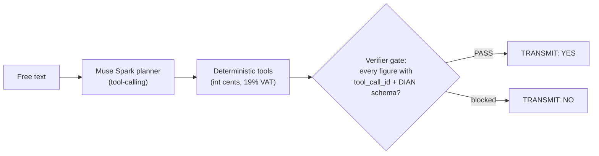
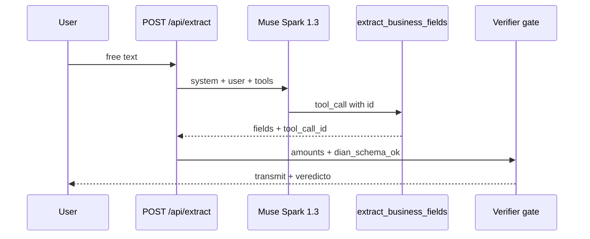

# Kreo.One — Agentic ERP SaaS (verifiable module: Kreo Fiscal Shield)


[](https://factura.kreo.lat)

**▶ Try the live demo: [https://factura.kreo.lat](https://factura.kreo.lat)** — type your company, generate an invoice, run the 20-case suite in your browser.

This public repo is the **verifiable, deployable module of the Kreo.One agentic ERP SaaS**: a conversational wizard (Muse Spark) that proposes, deterministic tools that compute, and a verifier that decides before transmitting. The ERP core (`kreo-one-skeleton`, PRIVATE GitHub) is not exposed here; this is its living public proof. Built for **Colombia**: DIAN electronic invoicing (19% VAT, COP cents, pre-transmit validation). A module of the [Kreo.One](https://kreo.one) ecosystem — the all-in-one ERP for Colombian SMEs.



## What it demonstrates

Voice/text → draft invoice → deterministic gate blocking every number without `tool_call_id` → DIAN schema validation → `transmit` only if the verifier passes.

## Architecture

`Muse Spark 1.3 (planner, OpenAI-compatible, tool-calling) → deterministic tools → verifier → transmit only on PASS verdict`. No key? Honest local mock (labeled on screen). Zero-float: `int` cents, no `float` for money. Full contract: [docs/LLM_CONTRACT.md](docs/LLM_CONTRACT.md).



## Run locally

```
pip install -r requirements.txt
python src/verify.py
python src/agent.py "invoice to client X for 2450000 + VAT"
PORT=8080 python src/server.py  # web demo: / (page), /health, POST /api/verify
```

## Deploy (Coolify, VPS-3)

`Dockerfile` stdlib-only. Public app built from this repo, build-pack `dockerfile`,
port 8080, health-check `/health`, domain `https://factura.kreo.lat`.

## Tests and deploy closure

```
python3 -m unittest discover -s tests   # 401 regression: quoted key authenticates alike
python3 scripts/post-deploy-check.py https://factura.kreo.lat --full   # counts-only closure, fail-closed (exit 1 on any failure)
```

`post-deploy-check.py` verifies health, verifier transmit/block, and that
extract carries the real Muse Spark seal (no seal = deploy not closed).
If `META_SPARK_API_KEY` is in your environment it only reports lengths, never the value.

## Traceability

Every draft figure references a `tool_call_id`. No `tool_call_id`, no transmit. See `src/verify.py`.

## KPIs (SaaS-S, verifiable)

- KPI-1: 100% figures with `tool_call_id` (0 written by the model).
- KPI-2: 100% DIAN Colombia schema pass before transmitting.
- KPI-3: p95 ≈0.3–0.5s text-to-draft, measured in production (server-side 20/20 suite via `scripts/post-deploy-check.py --full`).

## Legal framework (reference, not compliance)

Design reference: Decree 2242/2015 (e-invoicing system), Decree 358/2020 (arts. 616-1 ff. of the Tax Code), DIAN Resolutions 042/2020 (sales e-invoice + technical annex) and 165/2023 (annex v1.9, CUFE/CUDE, UBL 2.1). Per-figure traceability (`tool_call_id`) mirrors the CUFE/CUDE philosophy; it is an analogue, not an equivalent.

*This demo does not transmit to DIAN nor generate tax-valid documents. Production requires DIAN habilitation, an invoicing resolution, a digital signature and an authorized technology provider. Validate with a tax accountant/attorney.*

## License

MIT — this slice only. The kreo.one core stays private.

<details><summary>Español</summary>

# Kreo.One — ERP SaaS agéntico (módulo verificable: Kreo Fiscal Shield)

Este repo público es el **módulo verificable y desplegable del ERP SaaS agéntico Kreo.One**: un wizard conversacional (Muse Spark) que propone, herramientas deterministas que calculan, y un verifier que decide antes de transmitir. El core del ERP (`kreo-one-skeleton`, GitHub PRIVATE) no se expone aquí; esto es su prueba pública viva. Hecho para **Colombia**: factura electrónica DIAN (IVA 19%, centavos COP, validación previa a transmitir). Módulo del ecosistema [Kreo.One](https://kreo.one) — el ERP todo-en-uno para pymes colombianas.

## Qué demuestra

Voz/texto → borrador factura → gate determinista que bloquea todo número sin `tool_call_id` → validación esquema DIAN → `transmit` solo si el verifier pasa.

## Arquitectura

`Muse Spark 1.3 (planner, OpenAI-compatible, tool-calling) → tools deterministas → verifier → transmit solo con veredicto PASS`. Sin key, mock local honesto (etiquetado en pantalla). Cero-float: centavos `int`, nada de `float` para dinero.

## Correr local

```
pip install -r requirements.txt
python src/verify.py
python src/agent.py "factura a cliente X por 2450000 + IVA"
PORT=8080 python src/server.py  # web demo: / (pagina), /health, POST /api/verify
```

## Deploy (Coolify, VPS-3)

`Dockerfile` stdlib-only. App publica desde este repo, build-pack `dockerfile`,
puerto 8080, health-check `/health`, dominio `https://factura.kreo.lat`.

## Tests y cierre de deploy

```
python3 -m unittest discover -s tests   # regresion 401: clave con comillas envolventes igual autentica
python3 scripts/post-deploy-check.py https://factura.kreo.lat --full   # cierre counts-only, fail-closed (exit 1 si algo falla)
```

`post-deploy-check.py` verifica health, transmit/bloqueo del verificador y que
el extract lleve el sello real de Muse Spark (sin sello = deploy no cerrado).
Si `META_SPARK_API_KEY` esta en su entorno solo reporta longitudes, jamas el valor.

## Trazabilidad

Cada cifra del borrador referencia `tool_call_id`. Sin `tool_call_id` no hay transmit. Ver `src/verify.py`.

## KPIs (SaaS-S, verificables)

- KPI-1: 100% cifras con `tool_call_id` (0 escritas por el modelo).
- KPI-2: 100% schema DIAN Colombia pass antes de transmitir.
- KPI-3: p95 ≈0.3–0.5s texto a borrador, medido en producción (suite server-side 20/20 vía `scripts/post-deploy-check.py --full`).

## Marco normativo (referencia, no cumplimiento)

Referencia de diseño: Decreto 2242/2015 (sistema de factura electrónica), Decreto 358/2020 (arts. 616-1 y ss. del E.T.), Resoluciones DIAN 042/2020 (factura electrónica de venta + anexo técnico) y 165/2023 (anexo v1.9, CUFE/CUDE, UBL 2.1). La trazabilidad por cifra (`tool_call_id`) refleja la filosofía CUFE/CUDE; es un análogo, no un equivalente.

*Esta demo no transmite a la DIAN ni genera documentos con validez tributaria. Producción requiere habilitación DIAN, resolución de facturación, firma digital y proveedor tecnológico autorizado. Validar con contador/abogado tributarista.*

## Licencia

MIT — solo este slice. El core kreo.one sigue privado.

</details>
